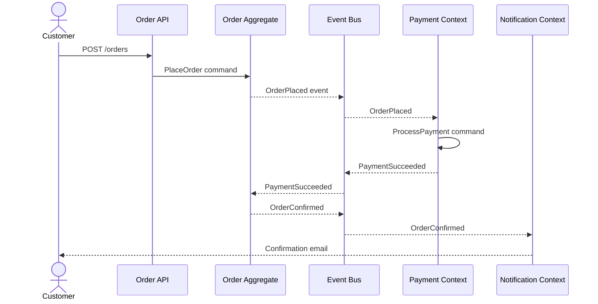
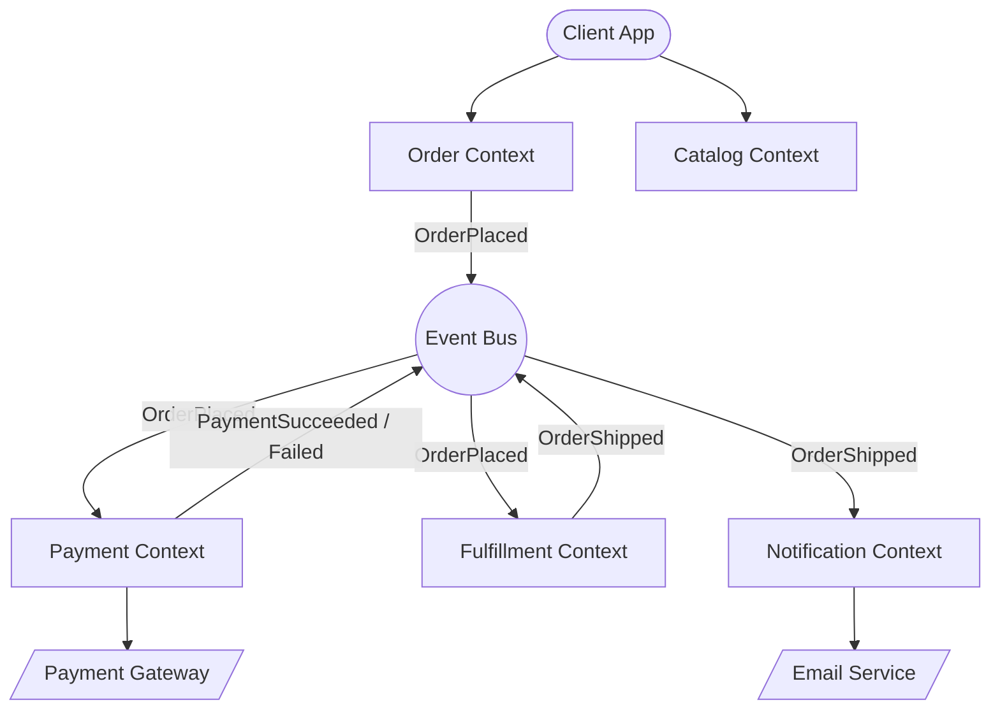

# Output Generation Guide

When the user is ready to generate deliverables, produce them one at a time so they can review and give feedback on each. Always ask which outputs they want first — don't dump all four unless they ask for everything.

The four outputs build on each other in this order:
1. **Miro Board Summary** (clean up the visual artifact)
2. **Requirements Document** (structured text for stakeholders)
3. **Function/API Map** (dev-ready specifications)
4. **Data Flow Diagram** (system-level view)

---

## Output 1: Miro Board Summary

Clean up and annotate the board so it reads clearly to anyone who wasn't in the session.

**Actions to take on the Miro board:**

1. Add a **legend frame** in the top-left corner with the color coding (a quick reference for anyone reading the board later)
2. Add **section header labels** for each phase (Big Picture / Process Modeling / Software Design) and each major domain boundary or flow
3. Create **frames** to group events that belong to the same bounded context or flow
4. Make sure **hotspots are visible** — don't bury them, they represent unresolved questions
5. Add a **"Key Insights" frame** summarizing the 3-5 most important discoveries from the session

Use `image_get_data` to review the board visually before and after cleanup. Use `diagram_create` to add structure, and `doc_create` / `doc_update` to place the legend and key insights as a document frame on the board.

After cleanup, share an image of the board with the user and ask: "Does this capture the session accurately? Anything missing or misplaced?"

---

## Output 2: Requirements Document

```markdown
# [Domain/Product Name] — Requirements Document
*Generated from Event Storming session — [date]*

## Domain Overview
[2-3 sentences: what this system does, who it serves, and what the core value proposition is]

## Bounded Contexts

| Context | Responsibility | Key Aggregates |
|---------|---------------|----------------|
| [Name]  | [What it owns] | [Aggregate names] |

## User Stories

### [Flow Name — e.g., "Customer Checkout"]

---

**Story: [Descriptive name]**

As a **[actor]**,
I want to **[command in plain language]**,
So that **[business value / outcome]**.

**Acceptance Criteria:**
- **Happy path**: Given [read model / precondition], when [actor issues command], then [event fires and system state changes]
- **Failure case**: Given [invalid condition], when [actor issues command], then [rejection event / error response]
- [Add additional scenarios as needed]

**Business Rules:**
- [Invariant: e.g., "An order cannot be shipped unless payment has been confirmed"]
- [Policy: e.g., "When order is placed, inventory must be reserved within 5 minutes"]

---

[Repeat for each major flow]

## Integration Points

| From Context | To Context | Event / API | Sync or Async |
|-------------|-----------|------------|--------------|
| [Context A] | [Context B] | [EventName or endpoint] | [sync/async] |

## Open Questions (Hotspots)

These were flagged as uncertain or contested during the session — they need resolution before or during development:

| Hotspot | Context | Priority |
|---------|---------|----------|
| [Description of the question/pain point] | [Where on the board] | [High/Medium/Low] |

## Assumptions Made During the Session
[Things assumed during modeling that should be validated with stakeholders or through testing]
```

---

## Output 3: Function / API Map

Organize by bounded context. Within each context, cover: aggregates, API endpoints, event handlers, and detailed function specs for the most important functions.

```markdown
# Function & API Map
*Tech stack: [language / framework from session context]*

---

## [Bounded Context Name]

### Aggregates

#### [Aggregate Name]

**Structure:**
```
[AggregateName] (Root Entity)
├── [Id] (UUID)
├── [SimpleField] ([Type])
├── [StatusField] (Enum: state1, state2, state3)
├── [ChildCollection] (Collection)
│   └── [ChildEntityName] (Child Entity)
│       ├── [field] ([Type])
│       └── [field] ([Type])
└── [ValueObjectName] (Value Object)
    ├── [field] ([Type])
    └── [field] ([Type])
```

**Lifecycle:**
```
[state1] → [state2] → [state3]
         ↘ [cancelled-state]
```

**Commands (Methods):**

| Method | Signature | Business Rule Enforced | Events Emitted |
|--------|-----------|----------------------|----------------|
| `[name]` | `([params]): [return]` | [rule] | `[EventName]` |

**Domain Events:**

| Event | Payload | When It Fires |
|-------|---------|--------------|
| `[EventName]` | `{ [field]: [type] }` | [condition] |

---

### API Endpoints

| Method | Path | Purpose | Auth | Events Triggered |
|--------|------|---------|------|-----------------|
| POST | `/[path]` | [purpose] | [role/token] | `[EventName]` |
| GET  | `/[path]/{id}` | [read model name] | [role/token] | — |

---

### Event Handlers / Policies

| Trigger Event | Handler | Action | Side Effects |
|--------------|---------|--------|-------------|
| `[EventName]` | `[HandlerName]` | [what it does] | [events emitted, external calls] |

---

### Detailed Function Specs

[Use this format for the 5-10 most important or complex functions]

**`[functionName]`**
- **Context**: [bounded context]
- **Purpose**: [one sentence]
- **Trigger**: [API call / event / scheduled]
- **Inputs**: [paramName: type — description]
- **Outputs**: [return type — success] / [ErrorType — failure condition]
- **Side Effects**: [events emitted, DB writes, external calls]
- **Business Rules**: [list of invariants enforced]
- **Error Cases**: [condition → how signaled]

---

[Repeat for each bounded context]
```

---

## Output 4: Data Flow Diagram

Generate as a Mermaid diagram. For complex systems, break into sub-diagrams per bounded context or per major flow — one large diagram is usually unreadable.

**Per-flow diagram template:**


**System context diagram template:**


After generating, ask the user: "Does this match your mental model of how data should flow? Any paths that look wrong or missing?"

---

## Output Delivery Checklist

Before delivering any output:
- [ ] All named domain events from the board are accounted for
- [ ] Actor names match the language the user used throughout the session
- [ ] All hotspots are either resolved in the output or listed as open questions
- [ ] Tech stack is reflected in function signatures and naming conventions
- [ ] No dangling references (every aggregate mentioned in an API spec exists somewhere in the aggregate definitions)
- [ ] Cross-context integrations are explicitly documented

## Delivery Tone

Give each output a one-sentence introduction that explains what it's for and who should read it. Then deliver it. Don't over-explain — the user can read it. End with: "Want me to adjust anything that doesn't match your understanding?"