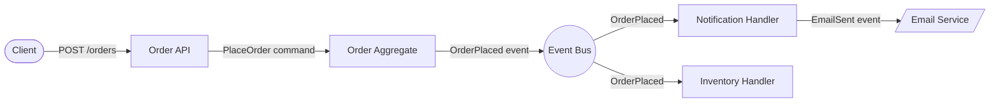

# Software Design Modeling — Facilitation Guide

Software Design translates your Event Storming model into concrete, buildable software components. This is where domain insight becomes code architecture. The goal is not a full system design document — it's a clear, accurate map that lets developers move fast with confidence.

## What You're Defining

| Concept | What It Is | Comes From |
|---------|-----------|------------|
| Bounded Context | A software boundary with its own model and team ownership | Domain boundaries from Big Picture |
| Aggregate Implementation | Class/entity with commands (methods), events, and state | Aggregates from Process Modeling |
| Read Model / Projection | Query result or DTO — what actors see | Read Models from Process Modeling |
| API / Endpoint | The public interface of a bounded context | Commands and read models at context boundaries |
| Event Handler / Policy | Code that reacts automatically to domain events | Policies from Process Modeling |
| Function Spec | Detailed spec for a specific function | All of the above, made concrete |
| Data Flow | How data moves between components | Integration points between contexts |

---

## Opening Questions (Ask Before Starting)

1. **Tech stack**: "What language and framework are you building in? Any architectural preferences — microservices, modular monolith, serverless, etc.?"
2. **Team structure**: "Are there multiple teams? Team boundaries often map well to context boundaries."
3. **Scale and reliability**: "Anything unusual about scale, latency, or uptime requirements we should design for?"
4. **Existing systems**: "Is any of this layered onto existing code or databases?"

The answers don't change the model — they change how you name and describe the outputs (e.g., a Python/Django project gets class-based aggregate names and Django REST framework endpoint notation, not Java interfaces).

---

## Translating the Model

### Bounded Contexts → Services or Modules

Each domain boundary from Big Picture becomes a **bounded context** — a deployable unit (microservice, module, or subsystem) with clear ownership and a defined public interface.

For each context, define:
- **Name**: A domain capability phrase ("Order Management", "Payment Processing", "Customer Identity")
- **Owned aggregates**: Which aggregates live here
- **Published events**: What this context emits that other contexts care about
- **Subscribed events**: What this context listens to from other contexts
- **Public API surface**: Endpoints exposed to external clients or other contexts

Ask the user: "Does this feel like it would be owned by the same team? Does it have its own database?"

### Aggregates → Classes / Entities

Each aggregate becomes a central class or entity. Visualize its structure as a tree — this makes the hierarchy of root entity, child entities, and value objects immediately clear:

```
Order (Root Entity)
├── OrderId (UUID)
├── OrderNumber (String)
├── Status (Enum: pending, confirmed, dispatched, delivered, cancelled)
├── CustomerId (UUID) ← reference, not embedded
├── OrderItems (Collection)
│   └── OrderItem (Child Entity)
│       ├── ItemId (UUID)
│       ├── ProductName (String)
│       ├── UnitPrice (Decimal)
│       └── Quantity (Integer)
└── DeliveryAddress (Value Object)
    ├── Street (String)
    ├── City (String)
    └── PostalCode (String)
```

Use this tree format consistently — it shows at a glance what the aggregate owns directly, what it references by ID (to other aggregates), and what sub-structures it contains. Always distinguish:
- **Root Entity**: The aggregate itself — has a globally unique identity
- **Child Entity**: Has identity within the aggregate, but not outside it (e.g., `OrderItem` makes no sense without its `Order`)
- **Value Object**: No identity — defined entirely by its values; immutable (e.g., `DeliveryAddress`)
- **Reference by ID**: A pointer to another aggregate — *never* embed another aggregate root inside yours

**Commands → Methods**: Each command becomes a method with clear signature, using domain language rather than CRUD:
- `place()`, `cancel()`, `approve()` — not `update()` or `save()`
- Include parameters, return value, and which business rule it enforces

**Events emitted**: Each domain event becomes a data structure:
- Event name (same past-tense name from the board)
- Payload: the data consumers need, expressed in the same tree-style notation if nested

**Lifecycle**: What states does this aggregate move through? Show it as a state chain:
```
pending → confirmed → dispatched → delivered
                   ↘ cancelled
```

### Policies → Event Handlers / Process Managers

Simple, immediate policies → **event handlers / listeners**:
```
on(OrderPlaced) → sendConfirmationEmail(order.customerId, order.id)
```

Long-running or cross-context policies → **sagas / process managers**:
```
PaymentSaga:
  start: on(OrderPlaced)
  step 1: command → ProcessPayment
  on(PaymentSucceeded): step 2 → command FulfillOrder
  on(PaymentFailed): compensate → command CancelOrder
```

### Read Models → Query Models / DTOs / Projections

Each read model from Process Modeling becomes a specific query or view. For each one:
- What data does it contain?
- How is it populated or kept up to date? (query on demand, materialized from events, cached?)
- What endpoint or function exposes it?

---

## Function Specification Format

Generate this spec for every significant function/method:

```
Function: [functionName]
Context: [bounded context / module name]
Purpose: [one sentence — what business need this serves]
Trigger: [what calls this — user API request, domain event, scheduled job, internal call]
Inputs:
  - [paramName]: [type] — [description]
Outputs:
  - [type] — [description of success case]
  - [ErrorType] — [what went wrong and when]
Side Effects:
  - Events emitted: [EventName with payload summary]
  - External calls: [service / API called]
  - Persistence: [what's written to storage]
Business Rules:
  - [Rule 1: invariant this function enforces]
  - [Rule 2: precondition that must hold]
Error Cases:
  - [Condition] → [how it's signaled — exception, error code, error event]
```

---

## API Surface Design

For each bounded context's external interface, define each endpoint:

```
[METHOD] /path/{param}
Purpose: [one sentence]
Auth: [required role or token type]
Request: [body schema or query params]
Response: [success schema]
Events triggered: [EventName, if any]
Error responses: [4xx/5xx codes and when they occur]
```

Group endpoints by resource/aggregate, not by operation type.

---

## Data Flow Notation

Describe how data moves between components. Use this format for describing flows in text, and generate a Mermaid diagram for visual representation:



For each cross-context integration, specify:
- **Sync or async?** (API call vs. event message)
- **Who is the consumer, who is the producer?**
- **What happens if the integration fails?** (retry, compensate, or accept eventual consistency?)

---

## Facilitation Questions During Software Design

These help the user make architectural decisions they might not realize they're making:

- "Should these two aggregates live in the same service, or would separate services give each team more independence?"
- "Who is the source of truth for this data? If two contexts both have a copy, which one leads?"
- "When Context A needs data from Context B — should that be a synchronous API call or an event subscription?" *(sync = tighter coupling, faster but fragile; async = looser coupling, more resilient but eventual consistency)*
- "Is this function expected to fail? How should it communicate failure — exception, error event, or return type?"
- "Could this aggregate eventually have millions of records? Does that change anything about the read model?"
- "Does this policy need to complete before the user gets a response, or can it happen in the background?"

---

## Design Signal Lookup Table

Common patterns from the Event Storming model → what they suggest in code:

| What You See on the Board | Design Signal |
|---------------------------|--------------|
| Many hotspots on one aggregate | Complex business rules — consider rich domain model with explicit validation |
| Policy that spans multiple aggregates | Saga / process manager needed — don't put cross-aggregate logic inside one aggregate |
| Same event triggers many different policies | Event bus / pub-sub pattern — don't hardcode each handler |
| Read model needs data from multiple aggregates | Materialized view or CQRS projection — don't join across aggregate boundaries at query time |
| External system in a critical flow path | Anti-corruption layer or adapter — isolate the external dependency |
| Two contexts need the same event | Define a shared integration event schema — each context owns its own internal model |
| Aggregate with many concurrent commands | Consider optimistic locking, versioning, or event sourcing |
| Long chain of policies across contexts | Choreography might get complex — consider an orchestrator/saga |

---

## Miro Layout for Software Design

Organize the board into bounded context frames:

```
┌──────────────────────────────────┐  ┌───────────────────────────────────┐
│ Bounded Context: Order Mgmt      │  │ Bounded Context: Payment Processing│
│                                  │  │                                    │
│  ┌──────────────────────────┐    │  │  ┌──────────────────────────┐     │
│  │ Aggregate: Order          │    │  │  │ Aggregate: Payment        │     │
│  │  + PlaceOrder cmd         │    │  │  │  + ProcessPayment cmd     │     │
│  │  + OrderPlaced event      │    │  │  │  + PaymentSucceeded event │     │
│  └──────────────────────────┘    │  │  └──────────────────────────┘     │
│                                  │  │                                    │
│  [OrderSummary Read Model]        │  │  [PaymentStatus Read Model]        │
│  [POST /orders endpoint]          │  │  [POST /payments endpoint]         │
└──────────────────────────────────┘  └───────────────────────────────────┘
                    ↕ Event: OrderPlaced (via event bus)
```

Use arrows to show cross-context event flows. Label the arrows with the event name and whether it's sync or async.

---

## When to Generate Outputs

When the Software Design phase is substantially complete (bounded contexts defined, aggregates specified, major APIs shaped), move to output generation. Read `references/output-generation.md` for the full output format.

The user should leave this phase with:
1. A Miro board they can walk any developer through
2. A function/API map with enough detail to start coding
3. A requirements document that any stakeholder can read
4. A data flow diagram that shows how the system holds together